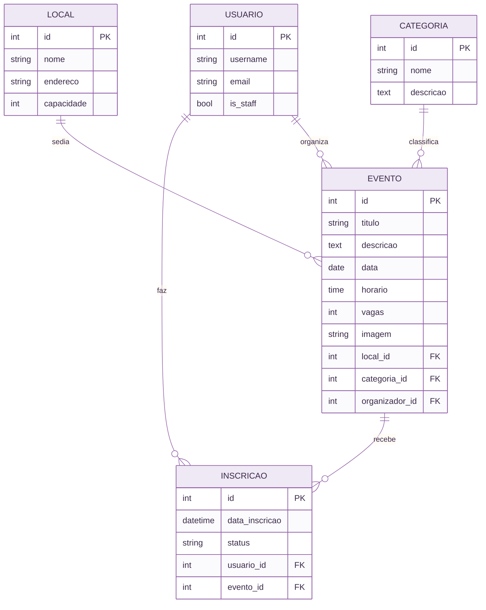

<div align="center">


### ✨ Plataforma de Gestão de Eventos ✨
*Descubra, inscreva-se e organize eventos em um só lugar.*


**Lumipass** é um produto da **Lume** · Projeto da disciplina **GAC116 – Programação Web** · UFLA

[Contexto](#-contexto) · [Problema](#-o-problema) · [Solução](#-a-solução) · [História de uso](#-história-de-uso) · [Instalação](#-instalação) · [Equipe](#-equipe)

</div>


## 🌌 Contexto

Eventos acontecem o tempo todo em ambientes acadêmicos e comunitários: palestras, oficinas, semanas
acadêmicas, encontros e feiras. Mas as informações ficam espalhadas em cartazes, grupos de mensagens e
redes sociais. Quem organiza precisa controlar inscrições e vagas, e quem participa precisa descobrir
o que está acontecendo e garantir sua presença.


## 🧩 O problema

- **Divulgação dispersa:** as informações de um evento ficam em vários canais e se perdem.
- **Inscrições manuais:** listas de papel, planilhas e formulários soltos geram erro, duplicidade e retrabalho.
- **Falta de controle de vagas:** é fácil lotar um local além da capacidade ou perder a conta de quem confirmou.
- **Pouca visibilidade para quem participa:** sem um lugar único, a pessoa não consegue pesquisar, filtrar
  por interesse nem acompanhar suas inscrições.


## 💜 Motivação

Organizar e participar de eventos ainda depende de processos manuais e de informação espalhada.
Queríamos um sistema **simples para quem participa** e **prático para quem organiza**, com uma
interface acolhedora e acessível, e que ao mesmo tempo nos permitisse aplicar, de ponta a ponta, o que
aprendemos em Programação Web: modelagem, regras de negócio, autenticação, painel administrativo e
interface.


## 🌱 Impacto social esperado

- **Mais acesso à informação:** todos os eventos em um único lugar, com busca e filtro por categoria.
- **Mais participação:** inscrever-se e cancelar em poucos cliques reduz a barreira para participar.
- **Menos desperdício e mais organização:** o controle automático de vagas evita superlotação e
  facilita o planejamento de quem organiza.
- **Fortalecimento da comunidade:** eventos acadêmicos, culturais e de extensão ganham alcance e visibilidade.


## 🌟 A solução

O **Lumipass** é uma aplicação web feita com **Django** onde:

- **Participantes** criam uma conta, exploram eventos, pesquisam, filtram por categoria, se inscrevem,
  cancelam e acompanham suas inscrições.
- **Administradores** cadastram eventos, categorias e locais, acompanham inscrições e gerenciam
  usuários em um ambiente administrativo personalizado (tema **Jazzmin**), com filtros, buscas e um
  painel com gráficos.

### Regras de negócio

> [!IMPORTANT]
> - O limite de vagas de um evento **não pode ultrapassar a capacidade do local**.
> - Cada usuário só pode ter **uma inscrição por evento**.
> - Não é possível se inscrever em eventos **encerrados** ou **esgotados**.
> - Cada usuário só acessa **as próprias inscrições**.


## 📖 História de uso

> [!NOTE]
> **Ana**, estudante de Ciência da Computação, quer participar de uma oficina, mas nunca sabe onde
> encontrar as informações.

1. Ana abre o **Lumipass** e cria sua conta em menos de um minuto.
2. Na página inicial, filtra os eventos pela categoria **Tecnologia** e busca por "oficina".
3. Abre os detalhes do evento: data, horário, local, descrição e **vagas disponíveis**.
4. Clica em **Inscrever-se**. A inscrição é confirmada e o número de vagas é atualizado.
5. Em **Minhas inscrições**, acompanha tudo e, se a agenda apertar, **cancela** com um clique,
   liberando a vaga para outra pessoa.

> [!TIP]
> **Maria**, organizadora, acessa o ambiente administrativo, cadastra o evento com local e vagas,
> acompanha as inscrições em tempo real e consulta o painel de gráficos para ver a procura por categoria.


## ✨ Funcionalidades

| 🟣 Participante | 🟡 Administração |
|---|---|
| Cadastro, login e logout | CRUD de eventos, categorias e locais |
| Ver eventos e detalhes | Ver e gerenciar inscrições (ação em lote) |
| Pesquisar e filtrar por categoria | Gerenciar usuários, grupos e permissões |
| Paginação da lista de eventos | Filtros, buscas e navegação por data |
| Inscrever-se e cancelar | Painel com gráficos |
| Ver minhas inscrições | Tema Jazzmin personalizado |
| Tema claro e escuro | Upload de imagem de capa do evento |


## 🗂️ Modelagem do banco de dados




## 🧰 Tecnologias

* **Python 3.12+** e **Django 6.1**
* **SQLite** (desenvolvimento) e **PostgreSQL** (Docker)
* **Bootstrap 5.3** e **Bootstrap Icons** (interface responsiva, tema claro e escuro)
* **django-jazzmin** (tema do ambiente administrativo)
* **WhiteNoise** (arquivos estáticos), **Pillow** (imagens) e **Chart.js** (gráficos)
* **Git**, **GitHub** e **Docker**


## 🚀 Instalação

Pré-requisitos: Python 3.12 ou superior e Git.

```bash
git clone https://github.com/tainarafms/plataforma-gestao-eventos.git
cd plataforma-gestao-eventos
python -m venv venv
```

Ative o ambiente virtual:

* Windows (PowerShell): `venv\Scripts\Activate.ps1`
* Windows (Git Bash): `source venv/Scripts/activate`
* Linux/macOS: `source venv/bin/activate`

Instale as dependências, crie o banco e popule com dados de exemplo:

```bash
python -m pip install -r requirements.txt
python manage.py migrate
python manage.py popular_dados
```

## ▶️ Execução

```bash
python manage.py runserver
```

Acesse [http://127.0.0.1:8000/](http://127.0.0.1:8000/). O ambiente administrativo está em
[http://127.0.0.1:8000/admin/](http://127.0.0.1:8000/admin/).

**Usuários de exemplo (apenas desenvolvimento):**

* Administrador: `admin` / `admin123`
* Usuários comuns: `maria`, `joao` e `ana` / `senha12345`

## 🧪 Testes

```bash
python manage.py test
```

## 🐳 Executando com Docker

```bash
docker compose up --build -d
docker compose exec web python manage.py popular_dados
```

Acesse [http://localhost:8000/](http://localhost:8000/). Para parar: `docker compose down`.


## 📁 Estrutura do projeto

```text
plataforma-gestao-eventos/
├── gestao_eventos/   # configurações do projeto (settings, urls)
├── usuarios/         # app: cadastro, login e logout
├── eventos/          # app: categorias, locais, eventos, inscrições, admin e painel
├── templates/        # templates compartilhados (base, navbar, erros)
├── static/           # CSS e JavaScript
├── docs/img/         # logo e imagens do README
├── Dockerfile
├── docker-compose.yml
├── requirements.txt
└── manage.py
```

## 🔀 Fluxo de versionamento

Branches: `main` (versões entregues), `develop` (integração) e `feature/*` (uma por funcionalidade),
integradas por Pull Requests.


## 👩‍💻 Equipe

<div align="center">

<table>
  <tr>
    <td align="center" width="220">
      <a href="https://github.com/carolinaude">
        
      </a><br>
      <b>Carolina Costa Ude</b><br>
      <a href="https://github.com/carolinaude">@carolinaude</a>
    </td>
    <td align="center" width="220">
      <a href="https://github.com/LeticiaGNM">
        
      </a><br>
      <b>Leticia Gabriella Nascimento de Morais</b><br>
      <a href="https://github.com/LeticiaGNM">@LeticiaGNM</a>
    </td>
    <td align="center" width="220">
      <a href="https://github.com/tainarafms">
        
      </a><br>
      <b>Tainara de Fátima Matias Souza</b><br>
      <a href="https://github.com/tainarafms">@tainarafms</a>
    </td>
  </tr>
</table>

*Lumipass · Lume · Projeto da disciplina GAC116 · UFLA*


</div>
